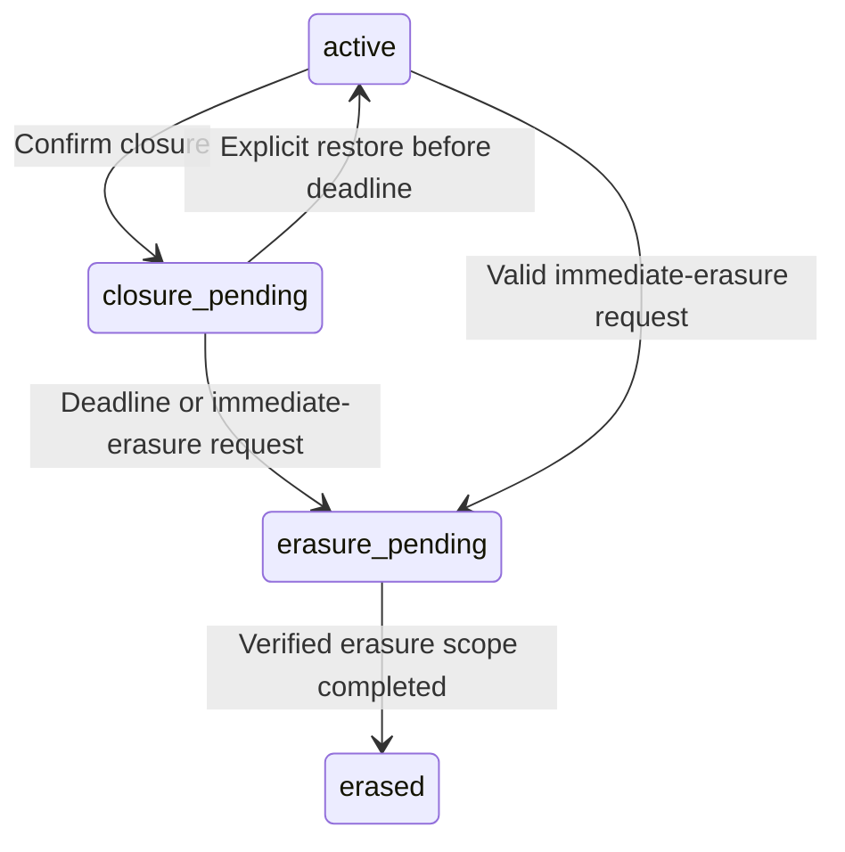

# Ulatus täpsustatud 22.11.2026

Kasutaja kinnitas ühe konto ja ühe valitud eraisiku või ettevõtte profiili avamismudeli.
Käesoleva varasema auditi mitme identiteedi, ettevõtte liikmete ja omaniku üleandmise
töövood ei ole avamisnõuded ega praeguse esimese mooduli eesmärk. Uus autoriteetne
ulatus ja tööjärg on `account-model-lifecycle-20261122.md` ning CURRENT_STATE.json.
Allolevad andmeseosed ja tervikluse leiud säilivad ajaloolise tehnilise sisendina;
nende vanu järgmise töö käske ei käivitata. Algne fail on muutmata history-kaustas.

---

# Account lifecycle — bounded server contract v1

Design date: 2026-11-22, Europe/Tallinn. Accepted source: `034211d`.
Status: reviewed design target; no endpoint, migration, close operation or eraser
has been implemented by this audit. Product summary: `account-lifecycle-audit-20261122.md`.

## Scope and staging

The first module is a read-only **account closure impact preview**. Account-wide
access state, reversible closure, restoration and final erasure are separate
subsequent slices. Each slice has its own verified database and browser result.
Do not ship a working-looking close/erase button with only preview authority.

Email activation remains a separate launch prerequisite before external users.
The preview does not send email or require a previously clicked confirmation.
Future sensitive mutations require fresh authentication for the same account.

## Account boundary

The subject is the authenticated login account, never merely the selected
identity. Derive the actor from the verified token; an expected user ID is only
a crossed-session guard. Do not accept an arbitrary user ID, email, business ID
or client-provided role as authority.

Identify these relationships separately:

- Personal identities actually owned by the account.
- Business memberships, including role and active/inactive state.
- Application ownership through `business_accounts.owner_user_id`.
- Inconsistent/orphaned ownership or historical author-only associations.

Application ownership is not a claim of legal ownership. An active co-member is
not automatically an eligible successor. A business identity, wallet or image
may outlive the account that created it. Historical business conversations are
bound to exact account/identity pairs; membership alone does not transfer them.

## Proposed module placement

| Layer | Proposed files and responsibility |
| --- | --- |
| Entity contract | `src/entities/accountLifecycle/model/closurePreview.ts`: versioned types, bounded parser, no UI text or Auth secrets. |
| Data access | `src/entities/accountLifecycle/api/getMyClosurePreview.ts`: one authenticated request, cancellation and typed failures. |
| Feature model | `src/features/account-lifecycle/model/useClosurePreview.ts`: account generation, abort and stale-result protection. |
| Feature UI | Small `AccountClosurePreviewPage` and grouped summary components; no authorization or raw database writes. |
| Route | A thin `app/v2/my-area/account/page.tsx` composition route, connected through the existing portal navigation conventions. |
| Database | Pure reader `public.get_my_account_closure_preview_v1(...)`; private helpers in a dedicated account-lifecycle schema where justified. |
| Later mutations | Small server-only authentication/command modules with explicit operation contracts; not part of preview. |

Account settings must remain reachable even when the account has no active
identity. Do not require publication readiness, an Energy balance, a paid plan
or a business membership to access one's own account lifecycle controls.
Preserve existing portal/V2 navigation context instead of creating a new portal.

## Preview RPC proposal

`get_my_account_closure_preview_v1(p_expected_user_id uuid, p_result_limit integer,
p_cursor jsonb)` returns a strict JSON envelope. Default page limit 20, maximum
50 identity/relationship groups; malformed cursors are rejected. Exact limits
must be verified against the actual indexed schema before implementation.

- Execute under the authenticated actor. Revoke anonymous/PUBLIC execution.
- If SECURITY DEFINER is necessary for scoped private summaries, use a fixed
  safe search path, fully qualified names and an explicit actor check before
  any row read. The definer must not return unscoped private data.
- Read a consistent statement snapshot with a bounded statement timeout.
  Avoid `FOR UPDATE`/`FOR SHARE`, row creation and shared mutation helpers.
- Verify live session/account validity on the server for lifecycle-sensitive
  reads; do not trust a decoded unverified JWT. Never expose `auth.sessions`
  or privileged credentials to the browser.
- No call to `ensure_my_energy_wallet_v2`, side-effecting read HTTP handlers,
  maintenance hooks, signed-URL APIs, Storage scans or external providers.
- Missing, drifted or unsupported schema is a typed incomplete result/error,
  never an empty success which advertises safe erasure.

The first implemented slice may cover account/identity/business relations only.
Every remaining domain must then be listed as `not_assessed`, with the overall
assessment `incomplete`. Future aggregates use the same envelope. Partial
delivery must not expose close/erase capability.

### Proposed response envelope

| Field | Contract |
| --- | --- |
| `schema_version` | Integer `1`; unknown versions rejected. |
| `actor_user_id` | Must equal the authenticated and expected account. |
| `scope` | Literal `account`; independent of current header identity. |
| `read_at` | Server timestamp. Informational, not an authorization grant. |
| `capabilities` | Preview slice: `{ preview: true, request_closure: false, restore: false, erase: false }`. |
| `assessment` | `complete_for_declared_scope` or `incomplete`, plus explicit scope version. Never `safe_to_delete`. |
| `relationship_groups` | Bounded personal/business groups; own public labels only when needed to identify a group. No member emails or a roster dump. |
| `domain_summaries` | Bounded structured summaries with coverage `assessed`, `not_assessed`, `unavailable`, or `inconsistent`. |
| `required_actions` | Finite reason codes, affected group and a supported next step. No raw SQL/provider error text. |
| `has_more`, `next_cursor` | Pagination for the declared group ordering. A page is not a complete account inventory. |

Counts use `{ value: decimal_string | null, relation: exact | at_least | unknown }`.
`unknown` must have `value: null`. Counts capped for bounded work use `at_least`.
Timeouts are not zeros. Multi-page summaries may change with concurrent work;
the preview is informational. Future mutation preparation recomputes relevant
scope server-side and binds an immutable, short-lived operation challenge to it.

### Domain adapters after core relationships

| Domain | Minimal allowed summary | Deliberately excluded |
| --- | --- | --- |
| Offers | Counts by personal/shared-business relationship and independent publication state for listings, horses, services, jobs and showcases. | Descriptions, private addresses and automatic status changes. |
| Conversations | Counts of exact account/identity participation and ambiguous legacy relationships. | Message text, peer emails, automatic teammate access. |
| Media | Selection/reservation/asset-state counts and unresolved ownership flags. | Object keys, signed URLs, image bytes, recursive Storage listing. |
| Energy | Existing wallet state; authorized exact bigint-safe paid/bonus/reserved totals; pending-operation/integrity indicators. | Wallet creation, refund, release or transfer commands; whole business balances labelled as personal. |
| Receipts | Categories and explicit policy status such as `policy_pending`. | Raw immutable JSON, internal operation keys, permanent-retention assumptions. |

Every domain distinguishes `not_created`/true zero from uninspected or inaccessible
data. The general diagnostic report contains schema metadata, not these personal
aggregates. Aggregates are returned only within the user's authenticated view.

## Future authoritative lifecycle state

Use one account-lifecycle record in a private schema, keyed by Auth user ID, with
explicit state, revision, request time and restoration deadline. The migration
must define existing-account initialization and new-account creation together.
Missing/invalid state must not silently grant access once lifecycle gates are on.
Do not duplicate writable lifecycle flags across profiles, identities and offers.

Proposed states are `active`, `closure_pending`, `erasure_pending`, `erased`.
`erased` is an operational completion state, not a claim that every retained
record/backup has ceased to exist; the completion receipt must name its scope.
Whether and how long a minimal completion receipt survives requires an explicit
retention decision. No permanent email hash blacklist is introduced.

The existing product direction is a clearly stated 30-day restoration option,
with an exact server deadline displayed in the user's timezone. It is a product
choice, not a universal legal retention period. Login never renews the deadline
or implicitly restores the account. An immediate erasure request has an explicit
handling path; it is not silently converted into mandatory 30-day retention.

Final erasure remains a separate disabled capability until category-specific
retention, receipt retirement, shared business and provider cleanup are settled.
Record a bounded, reviewable reason if an erasure task cannot complete; do not
restart its waiting period or claim completion from a single attempted DELETE.

## Reversible closure invariants

1. Commit the account access/visibility restriction atomically with its revision
   and operation receipt; do not start by deleting Auth, identities or content.
2. Preserve each offer's status, expiry, moderation, categories and image selection.
3. Stop new ordinary mutations, allocations, contacts, sends and attachments by
   the closed account. Apply this at DB/RLS/RPC and legacy direct-write surfaces.
4. Check recipient availability separately from historical thread membership.
   Preserve the remaining participant's authorized history during this stage.
5. Hide the personal profile and personal offers through canonical public readers.
   Resolve business scope explicitly; never infer that all managed content belongs
   to the departing account.
6. Enforce lifecycle at final publication/adoption/attachment after external I/O.
   A concurrent close and publish must have one defined serialized outcome.
7. Let narrowly authorized workers reconcile exact operations issued earlier.
   Closure does not authorize new content, new charge or blanket reservation release.
8. Revoke affected refresh sessions and apply a database lifecycle fence for older
   access tokens. A fresh restricted login may show account status/restore only.
9. Restoration rechecks current ownership, membership and moderation. It restores
   no revoked membership, closed offer, expired content or independent block.
10. Only after all access surfaces are covered may the closure control be enabled.

Use short compatible lock ordering for mutation fences. Do not put network I/O
inside a long database lock. Snapshot reads already running when closure commits
may finish under the prior snapshot; final mutations must recheck the fence.
Existing public image URLs and downloaded copies need their own delivery/retention
scope. Do not promise retroactive revocation through an account flag.

## Future fresh-authentication and command contract

The preferred current-password flow uses the existing Auth provider, with server
verification that the fresh password-authenticated user is the same target
account. Preserve password bytes exactly; do not inherit the old login form's
password trimming into this sensitive operation. Never record passwords, access
tokens, refresh tokens or email codes in application logs, reports or receipts.

Two implementation invariants are mandatory regardless of UI transport:

- Verification is server-enforced. A client boolean, recent JWT `iat`, token
  refresh, email-confirmed flag or decoding alone is not fresh authentication.
- Successful proof is short-lived, single-use and bound to account, current
  live session, operation kind, expected lifecycle revision and confirmed scope.
  Account switch, scope change or proof expiry requires a new proof.

Before choosing the exact password proof mechanism, verify the installed Auth
session/AMR contract. A separate password sign-in must not silently replace the
browser's account, bypass MFA or leave an unmanaged reusable session. Any
temporary session needs defined token handling and disposal. Unsupported login
methods fail with a supported recovery path; do not invent an email fallback.

The later server command must enforce trusted origin/CSRF boundaries, bounded
body size, provider-backed password attempt limits and additional narrowly scoped
rate controls. An operation key binds one exact request digest to one receipt.
Unknown network outcome leads to receipt/status reconciliation, not a new command
with a new key. Deadline/timeout never certifies that a mutation did not occur.

Separate `request_closure`, `restore` and final-erasure authorization. The preview
does not create those proofs. Keeping the first module free of these mutations
lets account/data relations be verified without endangering existing accounts.

## Sources and implementation gate

Repository evidence is indexed in `evidence/source-references.json`; reviewed
Supabase/OWASP references are in `evidence/external-sources.json`. These are design
inputs, not proof that the live deployment already enforces this contract.

Before the preview SQL is written against production, obtain the narrow metadata
contract in `account-lifecycle-verification-plan-v1.md`. Before any mutation,
verify every active access path and the authoritative lifecycle migration with
synthetic concurrency/auth tests, fresh build and real user-flow evidence.
